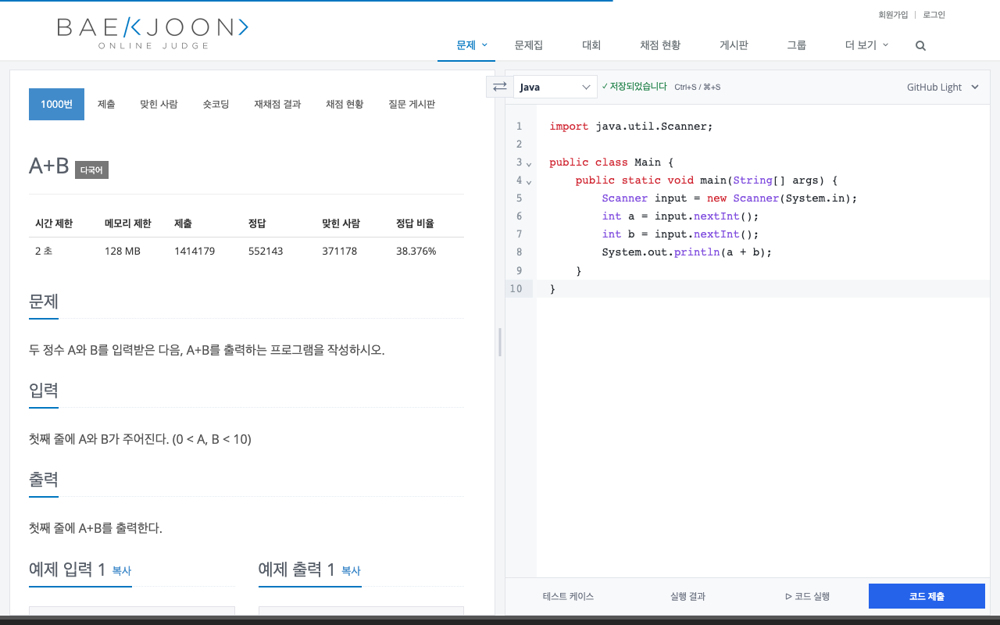
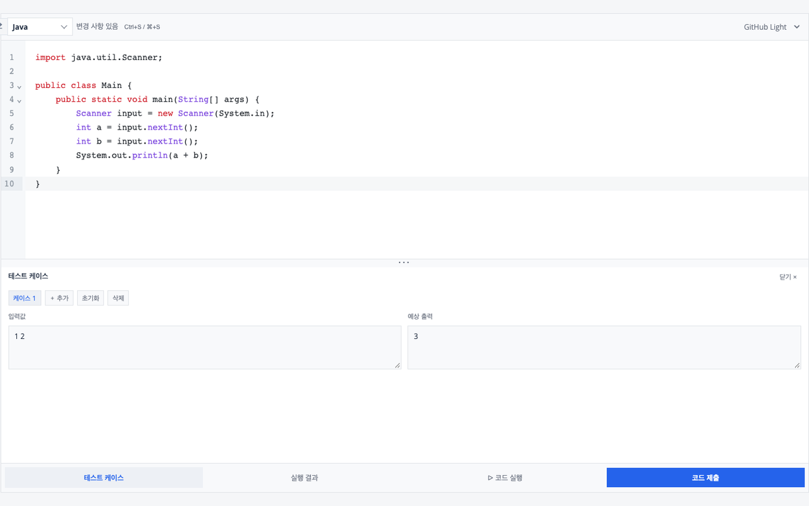
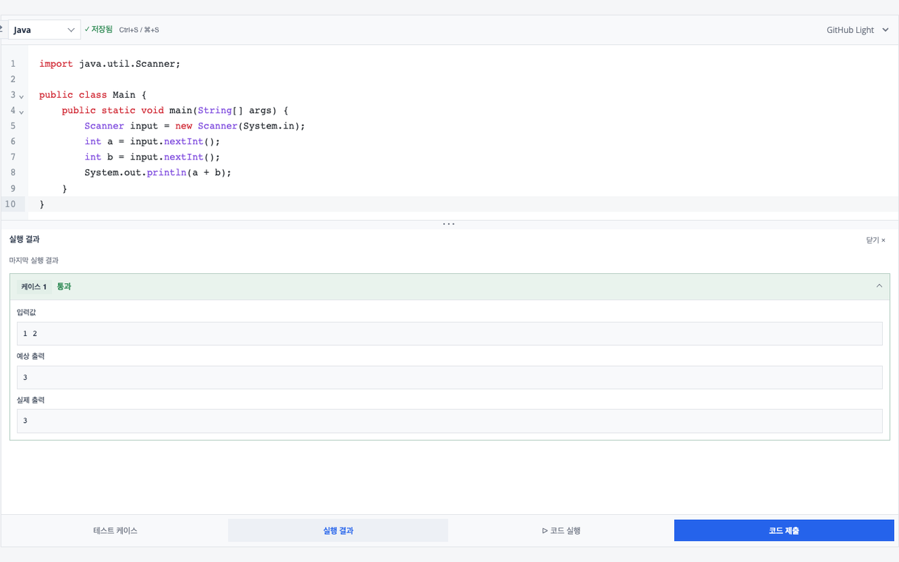

# Welcome Baek

**백준 문제를 보면서 같은 화면에서 코드를 작성하세요.**

Welcome Baek은 백준 온라인 저지의 복귀를 기념해 만든 비공식 Chrome 확장 프로그램입니다. 문제 설명과 예제를 보면서 풀이를 작성할 수 있도록 백준 문제 페이지에 코드 에디터를 추가합니다.



## 주요 기능

- **한 화면에서 문제 풀이** — 문제와 에디터를 나란히 보고, 두 영역의 너비와 위치를 바꿀 수 있습니다.
- **편집과 자동 저장** — Java, C, C++, C#, Python, JavaScript의 문법 강조를 지원합니다. 작성한 코드를 문제와 언어별로 브라우저에 저장해 다시 열면 이어서 편집할 수 있습니다.
- **테스트 케이스 실행** — 백준 예제를 사용하거나 입력과 예상 출력을 직접 작성할 수 있습니다. 등록된 모든 케이스를 순서대로 실행하며, 결과 패널에 대기 중·실행 중 상태와 완료된 케이스의 결과를 즉시 표시합니다. 케이스별 예상 출력과 실제 출력을 비교할 수 있습니다.
- **백준 제출 화면 연동** — **코드 제출**을 누르면 백준 공식 제출 화면에 작성한 코드와 언어가 채워집니다. 언어와 공개 범위를 확인한 뒤 직접 제출합니다.

> **실행 지원 범위** · 로컬 실행은 Java 11에서 지원합니다. 브라우저에서 등록된 테스트 케이스 전체를 순차 실행하며, 별도 JDK 설치가 필요 없습니다. 소스는 한 번 컴파일해 전체 케이스에서 재사용하며, 케이스마다 독립된 실행 환경을 사용합니다.

## 백준 1000번으로 살펴보기

| 테스트 케이스 편집 | Java 실행 결과 |
| --- | --- |
|  |  |

- [실행 실패 시 예상 출력과 실제 출력 비교](docs/store-screenshots/03-failed.png)
- [백준 제출 화면에 Java 11 코드 자동 입력](docs/store-screenshots/05-submit.png)

## 로컬 설치

1. 저장소를 내려받은 뒤, Node.js 24 LTS(24.15.0 이상) 환경에서 아래 명령을 실행합니다.

   ```bash
   npm ci
   npm run build
   ```

2. Chrome 주소창에서 `chrome://extensions`를 열고 **개발자 모드**를 켭니다.
3. **압축해제된 확장 프로그램을 로드합니다**를 누르고 빌드된 `dist` 폴더를 선택합니다.
4. [백준 1000번 A+B](https://acmicpc.net/problem/1000)를 열면 문제 옆에 에디터가 표시됩니다.

## 개발 및 지원

- [Java 실행 성능과 검증 방법](docs/JAVA-PERFORMANCE.md)
- [개발 로드맵과 기술 스택](docs/ROADMAP.md)
- [개인정보처리방침](blob/main/PRIVACY.md)
- [버그 제보 및 기능 제안](https://github.com/jamonda1/welcome-baek/issues)
