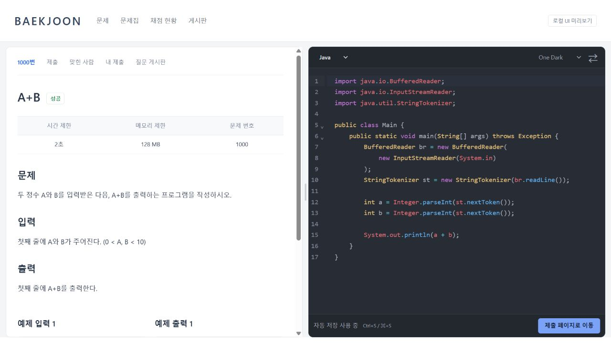

# 편집 화면 디자인 정리 및 안정화

2026-11-23 · Windows `welcome-baeck` · `develop`의 `63be3ad` 기준 · 확장 프로그램 버전 0.3.0.

## 디자인 방향

사용자가 지정한 [코드트리 문제 화면](https://www.codetree.ai/ko/frequent-problems/samsung-sw/problems/commissariat/description)을 실제 브라우저에서 확인했다.
얇은 상단 도구 모음, 넓은 편집 영역, 하단 행동 버튼, 문제·코드의 독립 스크롤을 참고했다.
CodeTree의 기능을 복제하거나 아직 구현하지 않은 실행 버튼을 배치하지 않았다.

- 큰 Welcome Baek 제목과 패널 안쪽 24px 여백을 없애 편집기를 넓혔다. 이름은 접근성 제목으로 유지했다.
- 상단에는 언어·테마·위치 반전, 하단에는 기존 저장 상태·재시도·제출 버튼을 배치했다.
- 상단은 약 44px, 기본 하단은 약 48px로 정리했다. 편집기는 나머지 높이를 사용한다.
- GitHub Light / One Dark / Dracula 테마를 도구 모음과 하단에도 적용했다.
- 문제와 코드 영역이 각각 스크롤된다. 현재 페이지의 헤더 높이에 맞춰 작업 영역을 계산한다.
- 좁은 패널에서는 단축키 도움말을 줄이고 버튼을 줄바꿈한다. 760px 이하 화면은 문제·에디터를 세로로 배치한다.
- 저장 실패 안내는 유지하며 긴 메시지는 내부에서 스크롤된다. 일시적인 제출 화면 열기 성공 안내는 4초 뒤 접는다.

## 안정화 내용

- 좌우 반전 시 DOM 노드를 재삽입하지 않고 CSS로 순서를 바꾼다. 에디터 노드·선택 위치를 보존한다.
- 문제 영역과 에디터의 여백 차이로 생기던 분할 비율 오차를 보정했다.
- 구분선에 키보드 조작을 추가했다. 방향키 2%, Shift+방향키 10%, Home 20%, End 80%이며 반전 방향을 반영한다.
- 드래그 중 다른 포인터는 무시하고, 취소·창 초점 이탈 시 원래 텍스트 선택 상태를 복구한다.
- 비어 있는 코드의 제출 이동 버튼을 비활성화한다. 500ms 자동 저장, Ctrl/Cmd+S, 초안·설정 복원, 코드 전달 동작은 유지한다.
- 제출 폼이 비활성화·읽기 전용이면 자동 입력하지 않는다. CodeMirror API가 아직 덜 준비되었으면 기다린다.
- CodeMirror가 비어 있어도 textarea에 남은 초안이 있으면 덮어쓰기 확인을 먼저 표시한다.
- 잘못된 전달 데이터는 코드의 문자열 메서드를 호출하기 전에 검증한다.

## 자동 검사와 브라우저 확인

`npm run typecheck`, `npm run build`, `npm test`가 통과했다. 기존 저장·제출 테스트 포함 **68개 통과**.
로그는 [타입 검사](design-typecheck.log), [빌드](design-build.log), [자동 테스트](design-test.log)에 있다.
Vite의 500kB 묶음 크기 경고는 남아 있다. `problem.js`는 약 635.46kB, gzip 약 215.04kB이다.

실제 dist를 로컬 브라우저에서 실행해 다음을 확인했다. Chrome Storage는 미리보기 전용 대역이며 실제 확장 프로그램 데이터는 사용하지 않는다.

| 확인 | 관찰 결과 |
| --- | --- |
| 1280×720, 분할 50:50 | 문제·편집 패널 각각 622px, 코드 영역 높이 517px. 패널 높이의 약 85% |
| GitHub Light / One Dark / Dracula | 편집기와 상·하단 색상 일치 |
| 반전 후 키보드 비율 변경 | 반전 방향과 20~80% 경계 정상 |
| 편집기 20% 너비 | 약 248.79px, 패널·페이지 가로 넘침 없음 |
| 720×900 | 세로 배치, 가로 넘침 없음 |
| 375×812 | 세로 배치, 페이지·도구 모음 가로 넘침 없음 |
| 문제에서 PageDown | 문제 scrollTop 약 248.67, 에디터 scrollTop 0, 페이지 scrollY 0 |
| Ctrl+S | ‘저장되었습니다’ 표시 |
| 저장 용량 초과 대역 | 실패·재시도 표시, 하단 버튼이 화면 안에 유지, 코드 영역 약 444.60px 확보 |
| 읽기 실패 대역 | 편집 잠금, 재시도 표시, 제출 버튼 비활성화 |
| 정상 미리보기 콘솔 | 오류 로그 없음 |

## 미리보기

실제 빌드를 사용하는 확인용 화면이다. 상단 백준 헤더·문제 HTML과 저장소는 검증용 예시이며 실제 백준 사이트를 그대로 캡처한 것은 아니다.

```powershell
npm run build
npm run preview:ui
```

[기본 미리보기](http://127.0.0.1:4318/problem/1000),
[One Dark](http://127.0.0.1:4318/problem/1000?theme=one-dark),
[저장 실패 확인](http://127.0.0.1:4318/problem/1000?theme=one-dark&fail=save),
[읽기 실패 확인](http://127.0.0.1:4318/problem/1000?fail=read).

저장 실패 화면에서는 에디터에 초점을 두고 Ctrl+S를 누르면 오류를 재현할 수 있다.
미리보기에서는 실제 백준 코드 제출을 수행하지 않는다. 미리보기 서버는 127.0.0.1에서만 실행된다.



다른 화면: [GitHub Light](ui-preview/editor-github-light.jpg), [Dracula](ui-preview/editor-dracula.jpg),
[좁은 패널](ui-preview/editor-narrow-pane.jpg), [작은 화면](ui-preview/editor-mobile.jpg), [저장 실패](ui-preview/editor-save-error.jpg).

## 실제 Chrome 적용 후 확인

1. 작성 코드의 저장 상태를 확인한 뒤 `chrome://extensions`에서 Welcome Baek을 새로고침한다. 버전 **0.3.0**을 확인한다.
2. 실제 백준 문제 페이지에서 F5를 누른다. 백준의 기존 헤더는 유지되고, 문제·편집기 내부에서 각각 스크롤되어야 한다.
3. 세 가지 테마, 언어별 저장본, Ctrl+S, 좌우 반전·드래그·키보드 조절과 새로고침 후 비율 복원을 확인한다.
4. ‘제출 페이지로 이동’에서 기존처럼 최신 코드가 전달되는지 확인한다. 최종 제출은 사용자가 직접 선택한다.

이번에는 로그인된 Chrome의 확장 프로그램을 자동으로 다시 로드하지 않았다. 실제 백준의 CSS·헤더와 조합된 최종 화면 확인은 남아 있다.
자동 채점 제출, 백엔드·컴파일러, 결과 자동 추적은 추가하지 않았다. 커밋·원격 푸시는 하지 않았다.

변경 파일: `public/layout.css`, `public/submit.css`, `public/manifest.json`, `src/content/problem.ts`,
`src/submission/bridge.ts`, `src/submission/transfer.ts`, `tests/problem.test.ts`, `tests/submit-bridge.test.ts`,
`preview/index.html`, `scripts/preview.mjs`, `package.json`, `README.md`.
