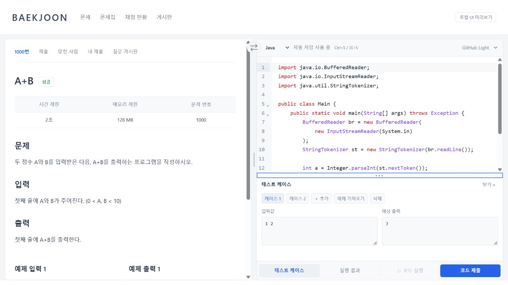

# 하단 테스트 케이스·실행 결과 패널

2026-11-23 · 확장 프로그램 0.4.0 · Windows `welcome-baeck`.

## 구현 범위

- 하단 고정 버튼: 테스트 케이스 / 실행 결과 / 코드 실행 / 코드 제출.
- 테스트 케이스·실행 결과는 같은 패널에서 전환한다. 같은 버튼을 다시 누르면 닫힌다.
- 상단 `•••`가 있는 가로 띠 전체를 드래그해 높이를 조절한다. 64px 미만으로 내린 뒤 놓으면 150ms 동안 접힌다.
- 닫기 버튼, Escape, 높이 조절 띠의 방향키(20px), Shift+방향키(50px), Home(최대), End(닫기)를 지원한다.
- 마지막 높이는 현재 페이지에서 기억한다. 새로고침 시 닫힌 상태로 시작한다. 에디터는 최소 160px를 확보한다.
- 문제의 `sample-input-N` / `sample-output-N` 쌍을 읽는다. 저장본이 없거나 초기화를 누르면 예제를 기본값으로 사용한다.
- 케이스 추가·수정·삭제, 입력값·선택 사항인 예상 출력 편집을 제공한다. 최대 50개. 초기화는 현재 문제의 목록을 원본 예제 입력·출력으로 교체하고 바로 저장한다. 예제가 없으면 빈 목록으로 저장한다.
- 테스트 케이스는 언어와 무관하게 문제별 `chrome.storage.local` 키 `welcome-baek:v1:cases:{문제ID}`에 저장한다. 입력 후 500ms 자동 저장, 입력칸 Ctrl/Cmd+S, 코드 영역의 저장, 페이지 이탈 처리에 연결했다.
- 저장 상태·오류·재시도는 기존 언어 선택 오른쪽에 통합했다. 케이스 읽기 실패가 코드 편집을 잠그지 않으며, 실패·잘못된 형식은 빈 데이터로 덮어쓰지 않는다.
- 결과 화면은 실행기 연결용 `WorkspaceDrawer.setResult`로 전달받은 코드·언어·케이스·출력의 복사본을 보관한다. 패널 닫기·화면 전환 후 다시 열어도 재실행 없이 표시한다. 코드·언어·케이스가 바뀌면 이전 결과임을 표시한다.

## 아직 연결하지 않은 기능

**실제 컴파일러·코드 실행기는 이번 범위에 포함하지 않았다.** 코드 실행 버튼은 비활성화하고 준비 중이라고 안내한다. 가짜 실행 결과를 만들거나, 코드를 외부 서버로 보내지 않는다.
실행 결과 보존·오류·이전 결과 표시는 자동 테스트의 실행 결과 샘플로 검증했다. 실제 실행 결과는 실행기 연결 후 확인해야 한다.
결과는 현재 페이지 메모리에만 유지된다. 새로고침·탭 종료 이후 실행 결과 복원은 아직 지원하지 않는다. 케이스는 새로고침 후에도 복원된다.

## 검증

`npm run build`, `npm run typecheck`, `npm test`: 자동 테스트 **84개 통과**.

로그: [빌드](workspace-build.log), [타입 검사](workspace-typecheck.log), [테스트](workspace-test.log).
기존 Vite의 500kB 묶음 크기 경고가 남아 있다.

실제 dist를 실행한 로컬 브라우저에서 다음을 확인했다. 저장소와 백준 HTML은 미리보기용 대역이다.

- 패널 열기·테스트/결과 전환·같은 버튼으로 닫기.
- 약 183px에서 327px로 드래그 확장, 64px 아래로 내려 닫기, 이전 327px로 다시 열기.
- 입력·예상 출력 편집 후 Ctrl+S, 화면 전환과 새로고침 후 케이스 2개 복원.
- 310px 너비에서 하단 버튼 2열 표시, 가로 넘침 없음, 에디터 약 269px 확보.
- GitHub Light / One Dark 테마에 맞는 패널 색상, 정상 미리보기 콘솔 오류 없음.

실제 Chrome 확장 프로그램의 백준 페이지 적용은 아래 수동 확인이 필요하다. 실제 백준 제출은 수행하지 않았다.

## 사용자 확인 절차

1. 코드 저장 후 `chrome://extensions`에서 Welcome Baek 새로고침, 버전 0.4.0 확인.
2. 백준 문제 페이지 F5. 기존 코드·언어·테마·분할 설정이 유지되는지 확인.
3. 하단 테스트 케이스 클릭 → 문제 예제, 추가·삭제·입력·예상 출력 편집 확인.
4. 상단 `•••` 띠를 위아래로 드래그. 아래로 끝까지 내린 뒤 놓아 닫기 → 테스트 케이스로 다시 열기. 높이와 내용 유지 확인.
5. 실행 결과로 전환, 닫기, 다시 열기. 실행기 연결 전에는 ‘아직 실행 결과가 없습니다’가 정상이다.
6. 입력칸 Ctrl+S 및 0.5초 자동 저장 후 F5. 문제별 케이스 복원, 상단 저장 안내 확인.
7. 코드 제출은 기존처럼 새 백준 공식 제출 탭으로 코드를 전달한다. 최종 제출은 직접 확인한다.

## 변경 파일

- `src/testing/cases.ts`: 예제 읽기, 저장 데이터 검증, 문제별 케이스 저장.
- `src/testing/drawer.ts`: 공유 패널, 드래그·접기, 케이스 편집, 결과 표시와 보존.
- `src/content/problem.ts`: 하단 버튼 및 상단 저장 상태 통합.
- `src/storage/storage.ts`: 공통 키 읽기·쓰기.
- `public/layout.css`, `public/manifest.json`: 화면 스타일, 버전 0.4.0.
- `tests/workspace.test.ts`, `tests/workspace-integration.test.ts`, `tests/load-error.test.ts`: 새 기능과 저장 회귀 검사.
- `preview/index.html`, `README.md`: 예제 DOM 및 사용 안내.
